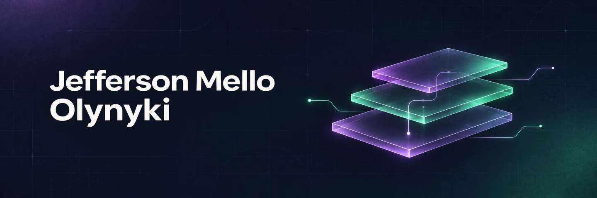

<h1 align="center">
  
</h1>

<strong>Tech Lead · C#/.NET · Backend e integrações</strong>

  
  

## Sobre mim

Atuo como **Tech Lead na Cúria Online do Brasil desde 2023**, com especialização em **C#/.NET**. Trabalho com APIs, microsserviços e integrações entre software e dispositivos, incluindo aplicativos Android para máquinas de cartão.

Comecei em QA na Unimake em 2015 e passei pelo desenvolvimento web e mobile e por projetos de IoT com Bluetooth Low Energy.

## Tecnologias e ferramentas

### Backend e APIs

  
  
  
  
  
  
  
  
  
  
  
  
  
  
  

### Frontend

  
  
  
  
  
  
  
  
  
  
  
  
  
  

### Mobile e dispositivos

  
  
  
  
  
  
  
  

### Bancos de dados

  
  
  
  
  
  
  

### Cloud e DevOps

  
  
  
  
  
  

### Ferramentas, automação e design

  
  
  
  
  
  
  

## Projetos e estudos públicos

| Projeto | O que você encontra |
| --- | --- |
| [**PolyGlot**](https://github.com/jeffersonmello/PolyGlot) | Aplicação web para traduzir PDFs e gerar os documentos traduzidos. |
| [**JSON para Dart**](https://github.com/jeffersonmello/Flutter-JSON-to-Dart) | Conversor de JSON para classes Dart com `fromJson` e `toJson`. |
| [**Multitenancy com ASP.NET Core**](https://github.com/jeffersonmello/aspnetcore.ef.migrations.multitenant) | Estudo de aplicações multitenant e migrations com Entity Framework Core. |
| [**.NET e AWS S3**](https://github.com/jeffersonmello/dotnet.aws.s3.console) | Experimento de integração com armazenamento de objetos. |
